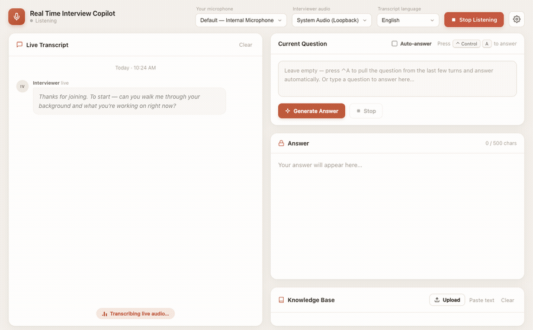
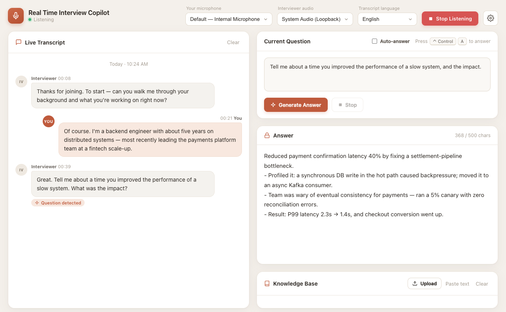

# Real Time Interview Copilot

[](https://github.com/chy-3825/mianshi/actions/workflows/ci.yml)
[](LICENSE)


[](#features)

**Hear the interviewer's question and draft your answer live.** Built for interview practice, mock interviews, and self-review.

> Fork of [ericwang915/interview-copilot](https://github.com/ericwang915/interview-copilot). The upstream MIT license and attribution are preserved in this repository.

> Real-time interview assistant — local Qwen3-ASR / SenseVoice or Deepgram transcription + LLM answers (DeepSeek / Gemini / OpenAI-compatible API / Ollama), grounded in your own documents.

A single-window Electron desktop app. It listens to a conversation, separates **you (microphone)** from the **interviewer (system audio)**, and on a hotkey detects the interviewer's current question and drafts a concise, first-person answer — using the last ~15 turns of dialogue plus any documents you upload as context.



<details>
<summary>Static screenshot</summary>



</details>

> 中文说明见下方 [中文](#中文)。

---

## ⚠️ Disclaimer — read this first

This tool is built for **interview preparation, practice, self-review, mock interviews, and accessibility assistance**.

Using real-time answer generation during a **live** interview without the other party's knowledge may violate the policies of the company you're interviewing with, employment agreements, academic-integrity rules, or local law, and many people consider it dishonest. **You are solely responsible for how you use this software and for complying with all applicable rules and laws.** The authors provide it "as is" with no warranty (see [LICENSE](LICENSE)) and do not endorse deceptive use.

## 🔐 Privacy — what leaves your machine

This app sends data to third-party APIs **only for the providers you configure**:

- **Audio** stays on your computer with the default local Qwen3-ASR mode. If you select Deepgram, audio is streamed to Deepgram for transcription.
- **Transcripts, your question, and selected document excerpts** are sent to your chosen answer provider unless you select local Ollama.
- API keys are stored **locally only**, in `app.getPath('userData')/settings.json` (e.g. `~/Library/Application Support/interview-copilot/settings.json` on macOS). They are never committed to the repo or sent anywhere except the provider's own API.
- Diagnostic logs are stored **locally only** in `app.getPath('userData')/session-diagnostics.jsonl` and may include transcripts, questions, and answers. Disable or clear them in Settings before sharing a machine or log file.

Want **zero cloud**? Use local STT together with **Ollama** as the answer provider. The current local STT setup targets an NVIDIA CUDA GPU; other hardware needs a separate setup or Deepgram.

---

## Features

- 🎙️ **Dual-channel transcription** — mic = candidate, system loopback = interviewer, transcribed separately and color-coded.
- ⌨️ **One-key answering** — press `Ctrl+A` (configurable): detects the interviewer's *current* question from the latest turns and streams an answer.
- ⚡ **Auto-answer (on by default)** — answers after the interviewer finishes a detected question; the toggle can turn it off. Near-duplicate ASR segments are suppressed briefly.
- 🧠 **Context-aware** — answers use the current question, recent dialogue, and relevant excerpts from uploaded résumé / JD / notes.
- 🎯 **JD customization** — paste or upload a job description in Settings; it's persisted and tailors every answer to the target role.
- 🔌 **Switchable providers** — DeepSeek, Gemini, OpenAI, or local Ollama, with automatic retry + model fallback.
- ✍️ **Concise, outline-style** answers (default ≤ 500 chars), shown alongside the detected question so you can edit and regenerate.
- 🖥️ **Single, clean UI** — live transcript on the left; question / answer / knowledge base on the right.

## Requirements

- **macOS 13+**, **Windows**, or **Linux** — runs on all three; system-audio capture is most seamless on macOS (see [Platform support](#platform-support)).
- **Node.js ≥ 18** (Node 20 LTS recommended; see `.nvmrc`).
- For local STT: Python 3 and an NVIDIA CUDA GPU; run `npm run setup:stt` once. Deepgram is an alternative that requires its own API key.
- For answers: a key for your selected provider (DeepSeek / Gemini / OpenAI-compatible API), or a local Ollama install.

## Quick start

```bash
git clone https://github.com/chy-3825/mianshi
cd interview-copilot
make run            # installs deps if needed, then launches the app
```

No `make`? Use `npm install && npm start`. Run `make help` to see all targets (`dev`, `test`, `lint`, `package`, …).

For the current NVIDIA local STT setup, run `npm run setup:stt` before the first launch; the default Qwen3-ASR model downloads during setup. Open **Settings** and configure an answer provider. If you select Deepgram instead, configure its key too. Then:

1. **Upload** a résumé / job description / notes (optional but recommended) into the Knowledge Base.
2. Click **Start Listening** and grant microphone (and, for interviewer audio, Screen Recording) permission.
3. Auto-answer is on by default. When the interviewer finishes a detected question, an answer is generated; press **`Ctrl+A`** (or click **Generate Answer**) to answer manually.

## Build a standalone app

```bash
# Build for THIS Mac's architecture (x64 or arm64), sign, and open — recommended
make app

# One .app that runs natively on both Intel and Apple Silicon
make universal

# Installers (electron-builder): dmg / nsis / AppImage
npm run dist          # current platform
npm run dist:mac      # mac — builds both x64 and arm64 dmgs
```

When builds are published on the [Releases page](https://github.com/chy-3825/mianshi/releases), choose the installer matching your system and processor.

The built app lives in `dist/`. For everyday use, launch the **packaged app** (double-click), not `npm start` from a terminal — on macOS the Screen-Recording permission attaches to the launching process, so a terminal-launched dev build can't reliably capture system audio.

## Installing a prebuilt release (macOS)

Prebuilt installers published on the [Releases](https://github.com/chy-3825/mianshi/releases) page may not be notarized. On macOS, follow the release notes if Gatekeeper blocks an installer.

- **Right-click the app → Open**, then click **Open** in the dialog (only needed once), **or**
- run `xattr -dr com.apple.quarantine "/Applications/Real Time Interview Copilot.app"` in Terminal.

After that it launches normally. (Building from source — `npm run package` — produces a locally-signed app with no such prompt.)

## Platform support

| Platform | Run it | Mic (candidate) | System audio (interviewer) |
|---|---|---|---|
| macOS 13+ | `make run` (builds & opens the app) or a `.dmg` | ✅ | ✅ Screen-Capture loopback — grant Screen Recording |
| Windows | `…Setup.exe`, or `npm install && npm start` / `make run` | ✅ | ✅ `getDisplayMedia` loopback (tick "share system audio") |
| Linux | `.AppImage`, or `npm install && npm start` / `make run` | ✅ | ⚠️ no `getDisplayMedia` loopback — pick a PulseAudio/PipeWire **Monitor** source under **Interviewer audio** |

`make run` adapts to the OS: on macOS it builds & opens the signed app (so the Screen-Recording permission attaches to the app); on Windows/Linux it launches via `npm start`. npm scripts are cross-platform (via `cross-env`).

**No-permission / fallback (any OS):** install a virtual audio device ([BlackHole](https://github.com/ExistentialAudio/BlackHole) on macOS, [VB-Cable](https://vb-audio.com/Cable/) on Windows) or use a system **Monitor** source, route the meeting app's output to it, and pick it under **Interviewer audio**.

## Architecture

```
src/
  main/                 Electron main process (Node)
    main.js             window, global hotkey, IPC, generation orchestration
    preload.js          contextBridge — safe renderer API
    settings.js         persisted settings (userData/settings.json)
    config.js           provider registry (models, base URLs, fallbacks)
    prompt.js           prompt builders (answer + question extraction) — pure, tested
    llm.js              provider-agnostic retry + fallback
    gemini.js           Gemini REST (SSE)
    openaiCompat.js     OpenAI-compatible client (DeepSeek / OpenAI / Ollama)
    store.js            knowledge base (question-based excerpt retrieval)
    documents.js        txt/md/pdf/docx parsing + chunking
  renderer/             UI (no Node access)
    index.html / styles.css / app.js
    deepgram.js         Deepgram live WebSocket client
    local-stt.js        local audio segmentation + STT request client
    question-detection.js  Chinese/English question detection
    pcm-worklet.js      Float32 → 16-bit PCM AudioWorklet
test/                   node:test unit tests
```

Key design notes:
- **Deepgram** runs in the renderer via a browser WebSocket using subprotocol token auth (`['token', key]`) — no SDK/bundler. See [SECURITY.md](SECURITY.md) for the trade-off.
- **Answer providers** run in the main process via REST/SSE — no third-party AI SDKs.
- Question detection uses only the latest turns; the answer is grounded in the broader recent history.

## Roadmap

- [x] Local STT (Qwen3-ASR by default; optional SenseVoice and faster-whisper backends)
- [ ] Bundle a cross-platform local STT runtime with installers
- [ ] Windows/Linux system-audio capture
- [x] Lightweight question-based retrieval for uploaded text
- [x] Auto-trigger on detected question end
- [ ] Answer history & export, i18n UI

## Contributing

PRs welcome — see [CONTRIBUTING.md](CONTRIBUTING.md). Security issues: see [SECURITY.md](SECURITY.md). Sharing it? There's ready-to-post copy in [LAUNCH.md](LAUNCH.md).

If Real Time Interview Copilot is useful to you, please **⭐ star the repo** — it genuinely helps others find it.

## Star History

[](https://star-history.com/#ericwang915/interview-copilot&Date)

## License

[MIT](LICENSE)

---

## 中文

基于 **本地 Qwen3-ASR / SenseVoice 或 Deepgram**（实时转写）+ **DeepSeek / Gemini / OpenAI 兼容接口 / Ollama**（答案生成）的桌面应用：双通道识别（麦克风=面试者、系统声音=面试官），默认自动回答检测到的面试官问题，也可按 `Ctrl+A` 手动回答；结合当前问题、最近对话和上传资料的相关片段生成第一人称答案。

**⚠️ 免责声明**：本工具用于**面试练习、复盘、模拟面试与无障碍辅助**。在**真实面试**中未经对方知情使用实时答题，可能违反对方公司政策、协议、学术诚信规则或当地法律，且通常被视为不诚信行为。**如何使用、是否合规由你自行负责**，作者不为此背书，软件按「现状」提供、不附带任何担保。

**🔐 隐私**：默认本地转写时音频不上传；选择 Deepgram 时音频会发送到 Deepgram。转写文本、问题与选中的资料片段会发送到你选择的远程答案 Provider；API Key 仅保存在本机 `userData/settings.json`。本地转写配合 Ollama 可让两步都在本机完成。

### Linux 首发体验

当前优先验证 Linux + NVIDIA CUDA。源码运行：

```bash
npm ci
npm run setup:stt
npm start
```

`setup:stt` 默认安装 Qwen3-ASR 0.6B 的运行依赖，并在安装阶段下载约 1.6 GB 模型（需联网和预留时间）。已有旧版默认 SenseVoice 配置会迁移到 Qwen3-ASR，自行选过的其他引擎或模型保留。若只想要更轻、更快的 SenseVoice，可运行 `bash scripts/setup-local-stt.sh --engine sensevoice` 并在高级设置中切换。首次启动向导默认使用本地中文转写；回答服务可选自定义兼容接口（需要你自己的 API Key）或本机 Ollama，不要求同时配置 Gemini 和 Deepgram。启动后先点“运行自检”，需要测实际语音时再点“录音自检”。自检只展示设备状态和耗时，不展示录音原文或密钥。

本地 Qwen 中文识别默认开启“领域词提示”：从项目名、项目关键词和少量技术词构建最多 128 字符、20 词的短提示，不把 README 全文送入语音模型。高级设置可关闭或补充少量术语；检测到疑似复读词表或空结果时，同一音频无提示重识别一次。

### 项目 README 知识库

在“知识库”点击“导入项目”，选择项目文件夹。程序只读取该文件夹根目录的 `README.md`（也支持 `README.markdown`、`README.txt`、`README`），并提示设置项目关键词。提问包含项目名、关键词或与 README 明确相关的内容时，回答会使用该项目的 README 片段；不相关问题不会附带其他项目资料。可在项目列表编辑关键词或移除项目；再次导入同一文件夹会更新 README 内容并保留手工设置的关键词。原有“上传文件”和“粘贴文本”仍可用，且与项目资料分开。

项目导入是本地静态快照，不会递归读取源码，也不会自动跟随 README 中的链接。若选择远程回答服务，命中的知识库片段会作为问题上下文发送给该服务；本地 Ollama 则不需要把这些片段发往云端。

回答时按问题范围选择资料量：细节问题通常检索至多 4 块相关片段，多部分问题至多 6 块。若已匹配一个项目，问题包含至少三个子问且其中至少两个涉及清单/数量/分类，README 又不超过 12000 字符并能完整放进设置的上下文上限，就保留全文，避免漏掉分类依据。“这个项目”类追问优先沿用最近明确提到的项目。未在 README 中明确记载的实现或分类仍需核对，不能把模型补充的推测当作项目事实。

应用打开后会在后台准备本地语音模型；自动答题会等待约 1 秒合并连续转写。自检页面会分别显示语音排队和推理耗时。诊断日志保存在本机，可用于排查启动、音频分段、检索和服务响应问题。

Run the automated checks with `npm test` and `npm run lint`.

Linux 安装包可通过 `npm run dist:linux` 构建，输出 AppImage 和 `dist/linux-stt-setup.tar.gz`。安装包**不内置约数 GB 的 Python/CUDA 环境或语音模型**；将配套压缩包解压后，在解压目录运行 `bash scripts/setup-local-stt.sh --user-install`，再启动 AppImage。首次安装需要网络、Python 3 与 NVIDIA 驱动；默认模型会在这一步下载。无 NVIDIA 显卡的机器目前不能直接使用此版本的本地转写，可在高级设置中选择 Deepgram（需各自的 Key）。Linux 采集面试官声音通常需要在设备列表选择 PulseAudio/PipeWire Monitor 或已配置的虚拟输入设备；自检中的设备检查不能代替真实通话测试。

自动作答默认开启，面试官说完一轮并识别为问题后生成一次回答；短时间内高度相似的转写不会重复触发。若想手动控制，可关闭主界面的“自动作答”。排查识别或回答错误时，可查看本机 `~/.config/interview-copilot/session-diagnostics.jsonl`：按时间记录切段、转写、触发/跳过原因、问题、回答及耗时，不保存原始音频或完整知识库/提示词。日志可能包含敏感的面试内容；可在高级设置中关闭记录或清空日志，勿公开分享。

当前版本仍在朋友测试阶段，不应将“单元测试通过”理解为不同 Linux 发行版和硬件均已验收。
